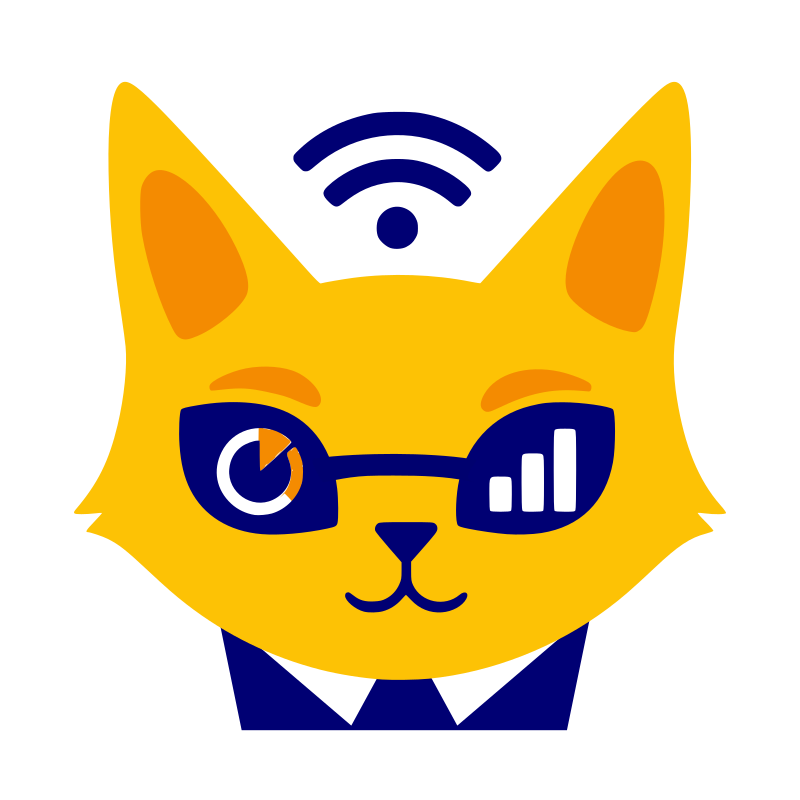

# CatCast



A tiny digital signage stack for places where you can't install software as
admin. Three pieces:

- **catstage** — fullscreen viewer (Tauri / WebView2). Drop the EXE on a
  machine, point it at a broker, walk away.
- **catsocks** — dumb WebSocket relay. Runs on Cloudflare Workers' free
  tier. Sees only opaque ciphertext.
- **catc** — the CLI. Drives one or many stages from your laptop.
- **catproxy** — optional same-origin rewriting proxy (Cloudflare Worker) for
  pages whose sub-resources get lost behind per-domain authenticating corporate
  proxies. See [workers/catproxy](workers/catproxy/README.md), including
  what to do when a kiosk lands on the corporate proxy's login page and
  how `catc trace` shows where a stage really is.

End-to-end encrypted. No accounts, no master server, no telemetry. Stage
state survives reboots and broker outages.

## Status

Early. v1 targets Windows x64 only — macOS / Linux / ARM distribution
may follow. The first install of a stage is a manual EXE drop; after
that `catc stage update` pushes a release to running stages: each one
downloads the asset (through catproxy's `/b64/` route as text, so a
content-sniffing corporate proxy never sees an executable), verifies the
SHA-256 **and an Ed25519 release signature**, swaps the binary in beside
itself, relaunches with its own arguments and keeps the previous binary
as `.old` for one generation. For kiosks whose proxy blocks the download
outright, `catc stage update --stream` pushes the verified binary over
the encrypted broker instead. `catc self-update` updates the CLI the same
way. Nothing updates on its own — there is no periodic check, by design.
WSL/Linux is the recommended dev path.

## Quick start

```bash
# 1. Deploy the broker (once per deployment)
cd crates/catsocks && wrangler deploy
# -> wss://catsocks.<your-acct>.workers.dev/r/<your-room>

# 2. On each stage machine
catstage.exe --install-autostart --socks wss://.../r/<room> --name kitchen --screen 2
# Optional: --screen is 1-based. If unavailable, catstage falls back to primary monitor.
# --socks is remembered: later starts can be plain `catstage.exe`.

# 3. On your laptop
catc init --socks wss://.../r/<room>
catc stage add kitchen        # the name shows on the stage's catcast://about page
catc config import config.yaml --name kitchen
catc nav https://example.com --for 5m
```

See `examples/` for `config.yaml`, `aliases.yaml`, and a default Rhai logic.

## Mirror a stage outside the network

For a screen in a building without access to the network your pages live
in. A stage **inside** (the relay) sends screenshots of what it shows to a
stage **outside** (the mirror), end-to-end encrypted through the same
broker. Pixels only: the mirror never loads the pages, so intranet logins,
JavaScript dashboards and canvas charts all come out as they look on the
relay. For static pages that change every few minutes; not for video or
animation.

```bash
# Outside: start a mirror. It picks a random 20-character name and shows
# it on its about page (F1) as text and QR code.
catstage.exe --install-autostart --socks wss://.../r/<room>-relay --mirror

# Laptop: register both stages, then pair them.
catc stage add lobby-relay
catc stage add <mirror-name-from-the-qr>
catc relay pair --relay lobby-relay --mirror <mirror-name> [--settle 3s] [--every 60s]
catc stage list --probe     # relay→<mirror> frame 12s / mirror frame 12s
catc relay off --relay lobby-relay --mirror <mirror-name>
```

- **The relay must be a visible screen.** It captures what its window
  shows; Windows stops painting a minimised or hidden WebView2. A real
  kiosk or a second monitor, not a minimised helper.
- **Only changed parts travel.** Screenshots are cut into 128-pixel tiles
  and the mirror keeps tiles by content. A page that comes back in the
  rotation costs a list of hashes; a clock ticking in a corner costs the
  one or two tiles under it. An unchanged screen sends nothing but a
  heartbeat every 10 minutes. The mirror marks its picture **STALE** after
  25 minutes without word from the relay, and shows the last picture after
  a reboot.
- **Secrets.** `relay pair` generates a random frame key and hands it to
  both stages inside the encrypted channel, so screen content is never
  encrypted under a guessable name. The pairing is sent under the mirror's
  name, which is why that name is random and why `relay pair` refuses
  names shorter than 16 characters. Frame traffic cannot carry commands:
  whoever holds the mirror box cannot steer the relay.
- **Not captured:** the relay's about page (it shows the relay's name,
  which is its key) and any page the relay is stuck on, like a proxy
  login.
- **Give the pair its own broker room** (`/r/<room>-relay`, with its own
  `catc.toml` via `CATC_CONFIG`). Every stage in a room receives every
  frame; it cannot read them, but it pays for them.
- **Traffic.** A full 1080p dashboard is roughly 0.3–1.5 MB the first time
  it is seen and a few KB per change after that, well inside the
  Cloudflare free tier. Sustained encrypted upload from inside the network
  may still catch a data-loss-prevention policy's eye; try it for a day
  first. And these pages leave the perimeter by design: check that their
  owner agrees.

## License

[0BSD](LICENSE). Use it. Fork it. Strip the credits. Sell it. Whatever.

## Contributing

Yes please. See [CONTRIBUTING.md](CONTRIBUTING.md). No CLA, no DCO, no
gatekeeping. Send a patch, an issue, or a sketch on a napkin.
